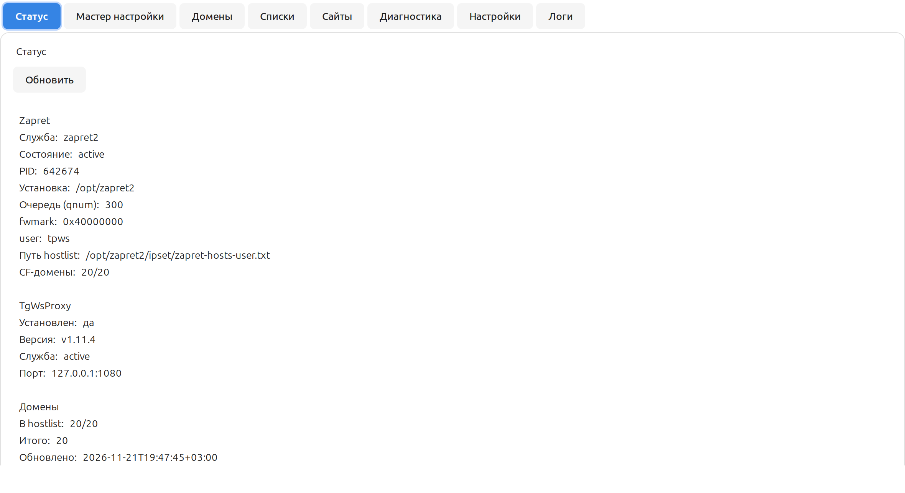
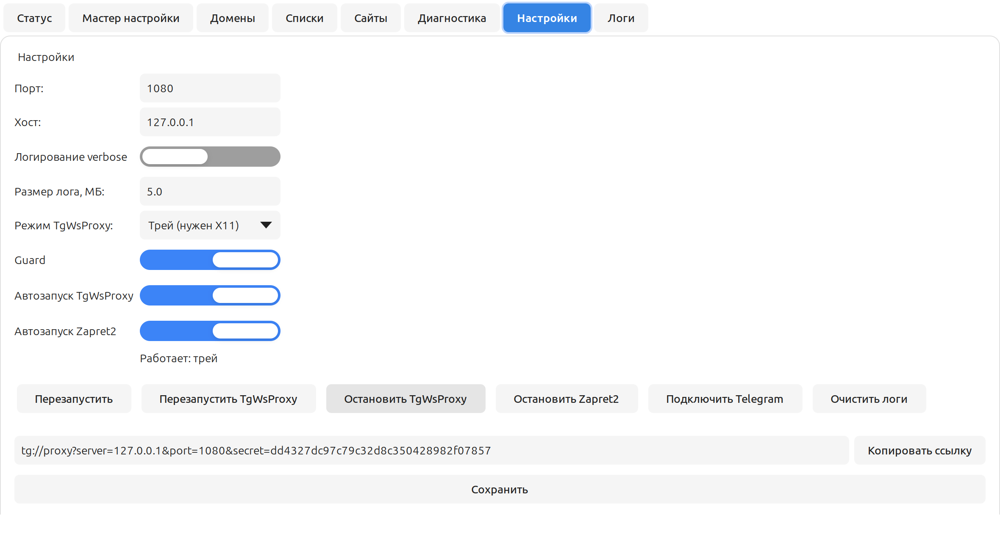
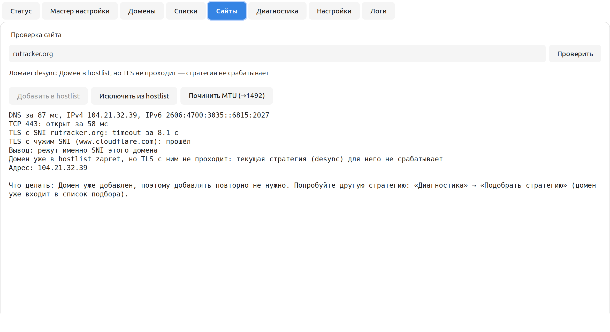
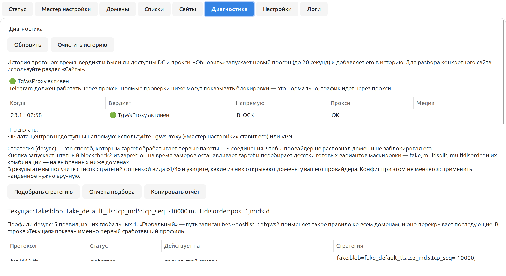
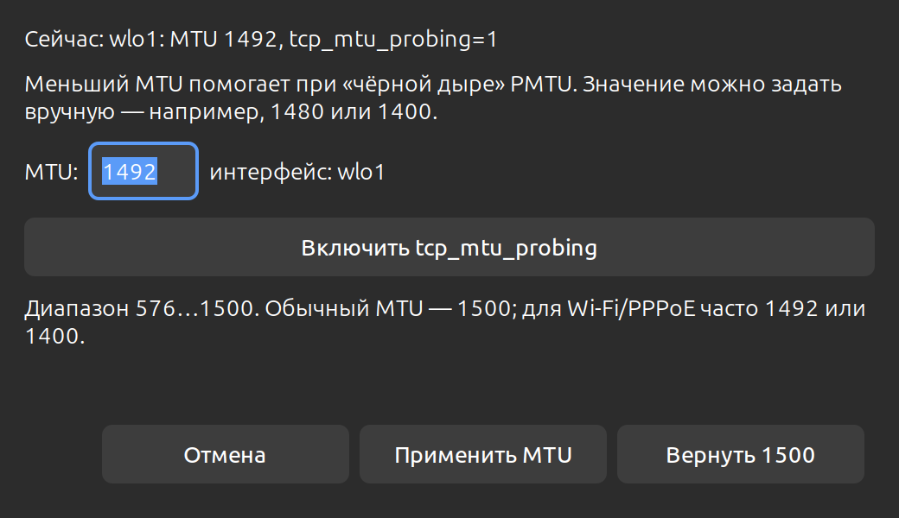

# LinFix

**Графическая панель для Linux**, которая превращает связку
**zapret2** (обход DPI через NFQUEUE) + **TgWsProxy** (MTProto-прокси для Telegram)
в управляемый продукт: поставил `.deb`, открыл окно, нажал «Далее» — работает.



## Как это выглядит

Панель — это одно окно с закреплёнными разделами: **Статус**, **Мастер настройки**,
**Домены**, **Списки**, **Сайты**, **Диагностика**, **Настройки**, **Логи**.
Плюс иконка в трее, которая меняет цвет по состоянию системы.

| Мастер настройки | Настройки |
|---|---|
|  |  |

| Домены TgWsProxy | Списки (hostlist) |
|---|---|
|  |  |

| Сайты | Диагностика (системный отчёт) |
|---|---|
|  |  |

| Диагностика Telegram |
|---|
|  |

## Что умеет

- **Мастер настройки** — пять шагов «Далее»: проверка системы → установка
  zapret2 из GitHub → установка TgWsProxy из GitHub → CF-домены → автозапуск.
  Пароль спрашивается только на привилегированных шагах (polkit/pkexec).
- **Статус** — служба, процесс nfqws2, очередь/разметка, hostlist, домены,
  TgWsProxy, порт и telegram-ссылка в одном экране.
- **Домены** — список CF-доменов **именно для TgWsProxy** (Cloudflare-путь к
  Telegram), а не список обхода zapret вообще. Обновление с GitHub, тест TLS
  по отмеченным или по всему списку, добавление и удаление доменов прямо из
  панели, с бэкапом hostlist и рестартом zapret.
- **Списки** — весь hostlist zapret: свои домены, импорт по URL или из файла,
  готовые источники (`get_antizapret`, `get_reestr`, `get_refilter`).
  Чужие строки LinFix не перезаписывает — правит только свои блоки.
- **Сайты** — проверка любого домена с объяснением причины: блокировка SNI,
  блокировка TLS на IP, «дыра» PMTU, только HTTP, DNS. Если причина —
  блокировка SNI и домена ещё нет в hostlist, он добавляется одной кнопкой.
  Если домен уже там, но TLS не проходит, вердикт честный: «стратегия не
  срабатывает», а не «добавьте домен».
- **Диагностика** — три блока:
  - системный отчёт: NFQUEUE, nftables, службы, hostlist, TLS до CF-доменов,
    VPN/TUN, guard;
  - **Диагностика Telegram** — состояние всего пути: DC на 443/80/5222,
    пинг до опорных узлов, подмена DNS (система vs DoH), задержки, скорость
    медиа. Таблица показывает два столбца — **Напрямую** и **Через
    TgWsProxy**: видно, что провайдер блокирует напрямую (`BLOCK`), а прокси
    этот путь обходит (`OK`). Проверка через прокси — настоящий MTProto-
    запрос (`req_pq` → `resPQ`), а не TCP-коннект;
  - **подбор стратегии** через штатный `blockcheck2.sh`: находит реально
    работающие у вашего провайдера варианты desync для выбранных доменов
    (список задаётся секцией `[blockcheck] domains`). Zapret на время замеров
    останавливается и включается обратно, в том числе при отмене; конфиг
    **не меняется** — вы получаете список строк для вставки.
- **Настройки** — порт, хост, verbose, размер лога, режим TgWsProxy
  (трей/CLI), guard, автозапуск, управление службами, ссылка `tg://proxy`.
- **Логи** — journalctl обеих служб + хвост `proxy.log`; поиск и «Обновить» сверху.
- **Трей** — цвет иконки отражает состояние, меню управляет службами.

## Проверка сайтов и MTU

Раздел **«Сайты»** объясняет, почему домен не открывается, вместо гадания:

| Вердикт | Что это | Поможет ли zapret |
|---|---|---|
| `ok` | сайт открывается | — |
| `sni` | режут имя домена, его нет в hostlist | **да** (добавить в hostlist) |
| `desync` | домен уже в hostlist, но TLS не проходит | нужна другая стратегия |
| `tls_ip` | режут TLS на IP при любом SNI | нет |
| `http_only` | HTTPS режется, HTTP работает | нет |
| `ip_block` | TCP не устанавливается | нет |
| `pmtu` | TLS проходит, но данные застревают | нет — проблема MTU |
| `dns` | имя не резолвится | нет |

Для `sni` внизу есть кнопка «Добавить в hostlist» — домен уходит в
пользовательский блок и zapret перезапускается. Если домен уже добавлен
(`desync`), кнопка неактивна: сначала подберите другую стратегию, иначе
домен останется совсем без обхода.

**Кнопка «Починить MTU»** есть в разделе «Сайты» всегда — MTU это
самостоятельная настройка, а не только реакция на вердикт.



В диалоге:

1. **поле MTU** — можно ввести любое значение 576…1500 (например, 1492 или 1400);
2. **`tcp_mtu_probing=1`** — ядро само подберёт MTU; мягко и обратимо;
3. **«Вернуть 1500»** — любой эксперимент обратим одним нажатием.

Всё идёт через helper с белым списком: разрешён только MTU, диапазон
576…1500, произвольные sysctl/команды недоступны. Увеличение MTU требует
явного флага, поэтому случайно «заявить» больше, чем пропускает провайдер,
нельзя.

**Про профили desync.** В «Диагностике» есть таблица профилей: видно, какие
правила реально работают, а какие nfqws2 игнорирует (путь к списку без
`--hostlist=`). Игнорируемый профиль — не поломка, правило просто не
применяется. Включать его вручную опасно: проверено, что такой профиль может ломать
TLS, из-за чего перестанут открываться CF-домены Telegram. Ничего менять не
нужно — таблица только показывает состояние.

**Про удаление CF-доменов.** Они критичны для TgWsProxy: без них прокси не
подключится. Поэтому и в «Списках», и в «Доменах» удаление таких доменов
требует двойного подтверждения с явным предупреждением, а «Списки» помечают
их как «CF (прокси) — нужен Telegram».

Вручную то же самое:

```bash
# посмотреть фактический MTU до сервера
ping -4 -M do -s 1464 -c 1 1.1.1.1   # проходит
ping -4 -M do -s 1472 -c 1 1.1.1.1   # не проходит → MTU 1492

sudo sysctl -w net.ipv4.tcp_mtu_probing=1   # временно
# или уменьшить MTU Wi-Fi: ip link set wlo1 mtu 1492
```

## Guard: защита от шторма соединений
Если CF-путь Telegram отваливается, клиент в цикле переподключается, и
TgWsProxy забивает канал соединениями — в итоге тормозит весь трафик, а не
только Telegram. **Guard** останавливает прокси в этом сценарии.

Раз в минуту он читает только новые строки `proxy.log`, считает
`CF proxy failed` за окно (по умолчанию 20 за 60 с) и, если порог превышен,
проверяет TLS до CF-доменов. Прокси останавливается **только если ошибки и
TLS-тест провален** — одного всплеска ошибок недостаточно.

С 0.5.11 Guard также ловит сломанный H2-путь к Cloudflare: если CF
открывает H2-канал, но не отдаёт заголовки ответа (медиа в Telegram не
грузится), Guard сам выключает H2 и перезапускает прокси на рабочий WS-CF
путь. Подробности: [docs/GUARD.md](docs/GUARD.md).

## Медиа Telegram: профиль zapret для CF (0.5.29)

Если текст в Telegram работает, а медиа не грузится, причина обычно в
профиле zapret: `tcpseg` режет TCP-сегменты и ломает передачу больших тел
через HTTP/2. Рабочий профиль — `fake` + `multidisorder` для CF-доменов:

```bash
sudo scripts/apply-cf-profile.sh
```

Скрипт делает бэкап конфига, создаёт hostlist CF-хостов, добавляет профиль
и проверяет H2 запросом на 256 КБ. Подробности:
[docs/SOLUTION-MEDIA-THROUGH-CF-2026-11-22.md](docs/SOLUTION-MEDIA-THROUGH-CF-2026-11-22.md).

### Кодировка списка доменов

В репозитории TgWsProxy домены лежат не открытым текстом, а «кодами»:
`.com`-строка сдвигается по буквам на число букв в имени и меняет TLD на
`.co.uk` (`virkgj.com` → `pclead.co.uk`). LinFix декодирует их тем же
алгоритмом, что и сам прокси.

```bash
linfix domains decode virkgj.com          # что это за домен
linfix domains decode --json khgrre.com   # машинный вывод
scripts/decode-cf-domains.py --upstream   # скачать и раскодировать список
```

Подробное описание алгоритма — в `scripts/decode-cf-domains.py`.

### Проверка профиля CF

Если медиа не грузится, а текст работает, проверьте профиль:

```bash
linfix domains profile
```

Команда делает TLS-хендшейк и HTTP/2 POST телом 256 КБ. Профиль `tcpseg`
открывает домен, но валит передачу тела — тогда команда так и скажет.
В панели то же самое — кнопка **«Проверить профиль CF»** в разделе «Домены».

### Свой Cloudflare Worker

Если публичные CF-воркеры недоступны или медленные, можно поднять свой —
медиа пойдёт потоком через WebSocket:

```bash
linfix tgws config --worker-domain <домен>.workers.dev
```

Код Worker'а и инструкция: [deploy/cf-worker](deploy/cf-worker).

```bash
linfix guard status   # включён ли и когда срабатывал
linfix guard check    # проверить сейчас
linfix guard on|off   # переключить
```

В панели — **Настройки → Guard**. Подробности: [docs/GUARD.md](docs/GUARD.md).

## Установка

### Из .deb

```bash
sudo apt install ./linfix_0.5.29_all.deb
```

Затем запустите **LinFix** из меню (или `linfix-gui`), откройте
**«Мастер настройки»** и нажимайте «Далее».

Зависимости ставятся через apt: `python3-gi`, `gir1.2-gtk-3.0`, `nftables`,
`curl`, `ca-certificates`, `git`, `pkexec`, `systemd`.

### Из исходников

```bash
git clone https://github.com/smartor777-sketch/LinFix.git
cd LinFix
make test     # 386 тестов
make gui      # запуск панели без установки
make deb      # → dist/linfix_<version>_all.deb
```

## Два режима TgWsProxy

TgWsProxy существует в двух видах, и LinFix поддерживает оба:

| | `tray` | `cli` |
|---|---|---|
| X11 / `DISPLAY` | нужен | **не нужен** |
| Иконка в трее | есть | нет |
| Для чего | десктоп | сервер, SSH, headless |

Переключение — в **«Настройки → Режим TgWsProxy»** или из терминала:

```bash
linfix tgws config --mode cli
linfix tgws restart
```

Порт, secret, `tg://`-ссылка и ротация лога общие для обоих режимов — они
хранятся в `~/.config/TgWsProxy/config.json`. Если `DISPLAY` недоступен,
LinFix сам выбирает `cli`.

## CLI (второй интерфейс)

Вся функциональность панели доступна и из терминала — удобно для серверов
и скриптов:

```bash
linfix status                  # сводка по компонентам
linfix doctor                  # полная диагностика (+ --json)
linfix domains update          # CF-домены → hostlist → рестарт
linfix tgws install            # TgWsProxy из GitHub (SHA256)
linfix tgws config --mode cli  # headless-режим
linfix tgws link               # tg://proxy-ссылка
linfix logs                    # журналы служб
linfix setup                   # мастер настройки в терминале
```

Привилегированные операции идут через `linfix-helper` — отдельный бинарник
с белым списком действий, вызываемый через pkexec и polkit-policy.

## Логи и их размер

- `~/.config/TgWsProxy/proxy.log` — ротация **5 МБ + 1 бэкап** (≈10 МБ).
  Меняется в «Настройки → Размер лога, МБ» или
  `linfix tgws config --log-max-mb 10`.
- «Настройки → Очистить логи» удаляет `proxy.log` и его бэкап.
- `journalctl` ограничен системно (`SystemMaxUse`, по умолчанию 500 МБ).

## Кириллица в пути

Клонируйте в путь без не-ASCII символов: `~/LinFix`, а не `~/Документы/LinFix`.
`pkexec` на части polkit-сборок падает на не-ASCII аргументах
(`g_variant_new_string: assertion 'g_utf8_validate' failed`), из-за чего
привилегированные действия не запускаются.

LinFix умеет обходить это (создаёт ASCII-обёртку во `/tmp`), но лучше просто
не создавать проблему — в ASCII-пути работает обычная ветка через `PYTHONPATH`.

## Безопасность

- Скачивание только по HTTPS; бинарник TgWsProxy — с проверкой SHA256.
- Список действий helper'а фиксирован, пути канонизируются и проверяются.
- Конфиг TgWsProxy пишется с правами `0600`, изменения — с бэкапом.
- В hostlist пишется помеченный блок; при неудачном рестарте — откат.

## Структура

```
src/linfix/            api.py, cli.py, helper.py, tgws.py, zapret.py, …
src/linfix/gtk/        GTK3-панель: окно, экраны, трей
packaging/debian/      control, обёртки, postinst/prerm, сборка .deb
data/                  polkit policy, systemd user-юниты, иконки
tests/                 231 unit-тест (stdlib unittest)
```

## Лицензия

MIT
